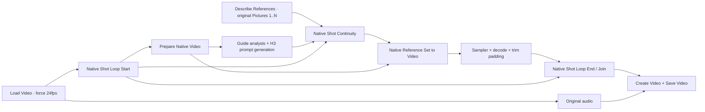

# Native H3 shot loop without Planner (experimental)

Requires BFSNodes **1.115.27**. Update, restart ComfyUI and refresh the browser.

Load [the auto-prompt loop workflow](examples/h3_tara_native_auto_prompt_loop.comfy.json)
(or [API graph](examples/h3_tara_native_auto_prompt_loop.api.json)). It is a separate
variant of the single-clip workflow, with the same models, reference description,
per-segment prompt generation and native H3 sampling. No Planner or Planner run
state is involved.

## Wiring

- **Loop Start:** default chunks of 107 source frames. Since **1.115.32**, choose
  `segment_unit=seconds` and set `chunk_seconds` (for example, 5 seconds = 120
  source frames), or keep `segment_unit=frames` and use `chunk_frames`. Only the
  selected field is used. Seconds round to the nearest 24 fps source frame;
  H3 padding is handled downstream and trimmed before joining. Old workflows
  retain their frame-based sizes. `camera_cuts` accepts
  comma-separated 24fps frame indices relative to the loaded clip. A cut always
  starts a new segment. Empty means one continuous take divided into chunks;
  **there is no automatic scene detection in these nodes**. Set VHS `force_rate`
  to 24 and `select_every_nth` to 1. Set cuts after any loader trim/skip.
- **Continuity:** enabled by default. After the first segment, append its last
  generated frame as the next native Picture. All user Picture indices remain
  unchanged. The appended instruction limits that image to appearance/scene
  continuity while the current guide supplies movement. Disable at camera cuts
  automatically; switch `enabled` off to disable it entirely. At most **8 user
  images** when continuity is active (H3 node limit: 9 including the anchor).
- **Loop End:** stores each decoded segment in the ComfyUI temp directory,
  expands only the start-to-end body, then concatenates the segments. Model
  loading/LoRA/TARA nodes stay shared outside the loop. Connect the final images
  to Create Video; connect original loader audio separately. Do not add final
  Save Video inside the repeated body.

Keep Prepare Native Video's `max_frames=0` and `frame_rounding=pad last frame`.
The example trims H3's `17n+5` padding before the join. A final segment under five
frames repeats its last source frame internally to meet H3's minimum; Loop End
keeps only its actual frame count. No overlap or crossfade is applied, so output
length remains the original loaded clip length at 24fps.

This is **soft native-image continuity**, not Add Guide, first-frame latent
locking or a guarantee of seamless boundaries. TARA can remain enabled because
no latent head/history guide is added. Continuity may still bias composition or
propagate errors; disable it to compare. There is no performer tracking in these
nodes: ambiguous source assignments after crossings/cuts still require suitable
prompts or bindings.

The temp manifest records the segment ranges and stored frame tensors. They are
not durable checkpoints or an automatic restart/resume mechanism. Float image
caches can be large; the final concatenation also uses CPU RAM. Remove the
corresponding `temp/bfs_h3_native_loop/<session>` folder after saving the final
video if it is no longer needed. Do not remove it while that run is active.

Validation: four CPU checks cover exact frame ranges/cuts, anchor ordering and
cut resets, short-tail trimming, actual ComfyUI GraphBuilder expansion and
bidirectional links in the example. No end-to-end GPU render, browser execution,
identity quality or seamlessness claim has been validated for this feature yet.
