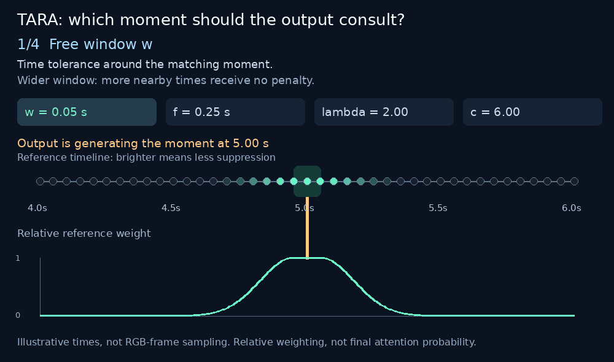

# TARA parameters, visually explained

TARA encourages an output moment to consult the **corresponding moment in the native reference video**, while leaving other moments available. These four controls shape that preference. They do not replace a suitable LoRA, accurate reference bindings or a correctly aligned time grid.

[Interactive version with sliders](docs/illustrations/tara_parameters_interactive.html): download the HTML file and open it in a browser; it is self-contained and works offline. GitHub's source view does not execute HTML. [Static diagram](docs/illustrations/tara_parameters_poster.png) · [Technical report](https://github.com/alisson-anjos/ai-toolkit/tree/tara-h3-v0.1.2/research/tara-h3).

## Start here

Use **w=0.20s, f=0.25s, λ=2.0, c=6.0** as the initial settings. Keep the seed, LoRA, prompt, source and output fixed while changing one control. More temporal pressure does not guarantee better video quality or identity.

| Parameter | Plain-language meaning | When increased |
| --- | --- | --- |
| **Free window w** (`window_seconds`), 0.20 s | Time tolerance with **no penalty**. At output time 5 s, reference times 4.8–5.2 s are inside the free window. | More nearby moments can be consulted freely; alignment becomes less selective within that band. |
| **Falloff f** (`falloff_seconds`), 0.25 s | How gradually the penalty grows **outside** the free window. It is a scale, not a second free interval. | Suppression grows more gently; smaller values make it grow more sharply. |
| **Strength λ** (`strength`), 2.0 | Multiplier for the temporal penalty outside the window. This is **not LoRA strength or reference-identity strength**. | Distant reference moments receive more suppression until the cap is reached. |
| **Cap c** (`max_penalty`), 6.0 | Ceiling on the penalty. Distant moments remain available rather than being hard-masked. | A larger maximum suppression is permitted. Raising it does not strengthen already-unpenalized matching moments. |

The animation's dots represent illustrative times, not the kernel's actual latent-frame sampling. The real rule acts on the packed latent timestamps. The graph is a **relative key-weight multiplier before attention normalization**, not a probability or a measurement of generated-video accuracy.

## One concrete example

For output time 5.0 s and reference time 5.4 s, the difference is 0.4 s. With defaults:

1. The first 0.2 s is inside the free window.
2. The remaining 0.2 s is divided by falloff 0.25 s and squared.
3. Strength 2 multiplies it: the penalty is 1.28.
4. This is below cap 6, so it stays 1.28. Its unnormalized contribution is multiplied by `exp(-1.28)`, about 0.278.

That does **not** mean attention has a 27.8% probability of picking that frame: other logits and normalization still matter. At cap 6, the multiplier is about 0.00248, which is small but nonzero. This is why TARA is a soft preference rather than a frame-deletion mask.

## Adjusting them without guessing

- **Start with the defaults.** Check the whole clip, especially the ending and quick actions.
- **Motion drifts:** first check that the correct Video 1 is selected and source/output use matching FPS, timestamps and frame windows. Stronger bias cannot repair a wrong source or shifted timeline. Only then experiment with a modest strength increase or smaller window/falloff, one at a time.
- **The performance looks constrained or artifacts increase:** try less strength or a wider window/larger falloff. These are tuning directions, not validated quality presets.
- **Identity/clothes drift:** inspect reference assignment, prompt, LoRA and image conditioning. These temporal controls do not directly increase identity-reference strength.
- **Need lower memory/cost:** change motion-reference resolution separately, starting at scale 1.0. A scale 0.5 gives roughly one quarter of the reference's spatial area, not one quarter of the entire model cost. Fine motions can be lost. Output resolution, LoRA strength, reference scale and these four temporal controls are different settings.
- **Backend selection:** Flash Partitions, Kitchen and sol-attn are execution implementations with different numerical/performance properties. Picking a faster backend does not change the meaning of w,f,λ,c or prove equivalent visual quality.

## Important: zero strength is not full TARA OFF

`strength=0` or `max_penalty=0` removes the temporal **bias**. The patch can still align temporal **RoPE** coordinates. For a proper native-reference TARA-OFF comparison, bypass the entire MODEL patch and route the original MODEL to both guider and scheduler, retaining the same native reference conditioning and LoRA. Switching to Add Guide is a different conditioning comparison.

Kernel downloads are optional for the optimized Kitchen/Sol path; they are not the method itself. [Kernel downloads and activation](H3_NATIVE_TEMPORAL.md#kernel-downloads) · [Manual installation / using an implementation without BFS](https://github.com/alisson-anjos/comfy-kitchen/blob/feat/h3-native-temporal/MANUAL_TEMPORAL_INSTALL.md).

## Em português

- **Janela livre 0,20 s:** para gerar o instante 5 s, os momentos 4,8–5,2 s do guia ficam sem penalização temporal.
- **Falloff 0,25 s:** controla a suavidade da queda fora da janela. Menor faz a penalização crescer mais rápido.
- **Força 2:** multiplica a penalização dos momentos distantes. Não é a força do LoRA nem da identidade.
- **Limite 6:** impede que a penalização cresça indefinidamente. Momentos distantes continuam disponíveis.

Comece nos padrões e ajuste um de cada vez. A imagem mostra uma preferência temporal, não uma garantia de sincronização. Zerar força ou limite desliga só o viés; para desligar TARA inteiro é necessário remover/bypassar o patch do MODEL.

## In-node temporal field monitor (1.115.23)

The standalone **BFS MiniMax H3 TARA - Native Temporal Alignment (Experimental)**
node includes an animated policy map. Change its parameters to see the free
window, falloff and capped penalty ranges update immediately. The two axes are
output time and guide time; a turquoise diagonal means low temporal penalty.
The local view auto-zooms to keep the falloff visible. The horizontal scanning
line is an illustration, **not an indication that diffusion renders frames
sequentially**.

The free range is `±window_seconds`. With nonzero strength and cap, the penalty
reaches its cap at `±(window_seconds + falloff_seconds * sqrt(max_penalty / strength))`.
A capped penalty is **not** a hard attention cutoff. Setting strength or cap to
zero disables the bias, while temporal RoPE alignment remains enabled.

During inference, real model-wrapper events report the evaluation number,
backend and token counts. An evaluation is not necessarily a sampler step
(e.g. CFG or a different sampler can evaluate more than once per step).
Reported time is host wall time; the monitor adds no CUDA synchronization.
The map is the applied bias policy, **not measured attention**, a decoded video
preview, or a prediction of output quality. Changes to widgets during a running
job affect the next queued execution; the current model keeps its queued settings.

Update BFSNodes, restart ComfyUI and hard-refresh the browser. This panel is
currently attached to the standalone TARA node, not the Planner conditioning node.

From **1.115.24**, the standalone node has a **Show TARA preview** switch.
Turning it off hides the panel, collapses its space and stops its animation.
The choice is saved as a workflow node property; it does not change TARA or sampling.
