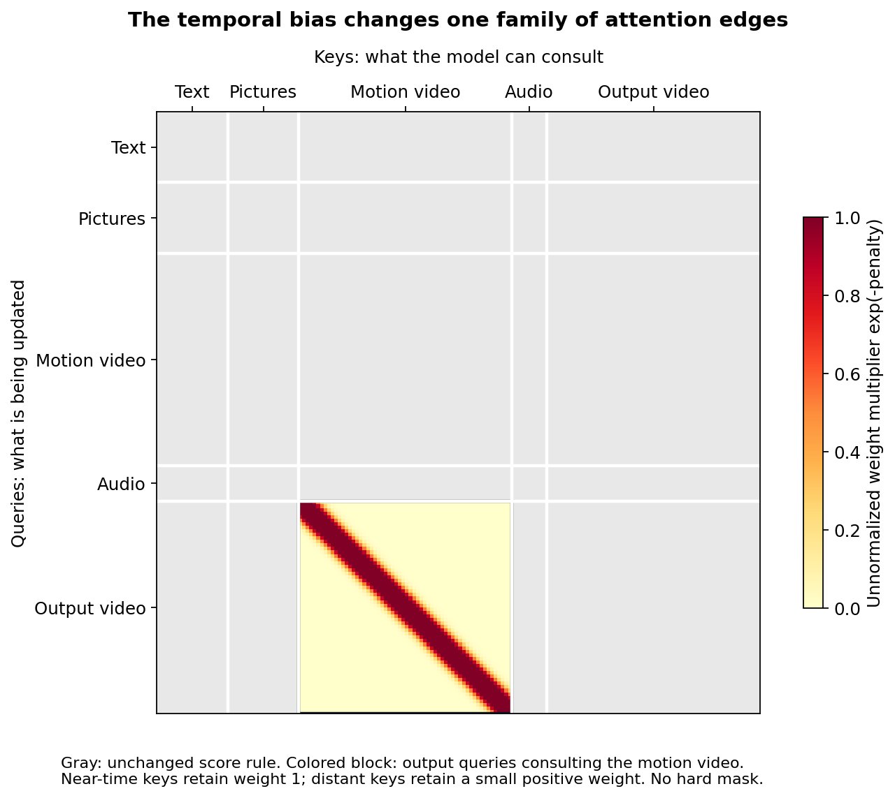
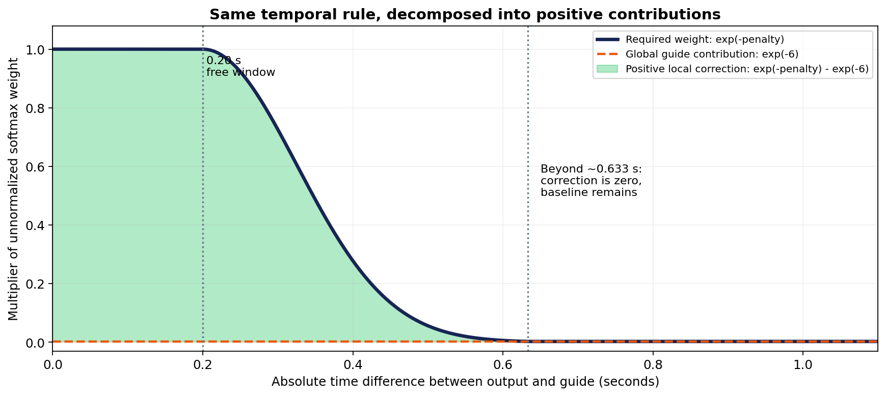
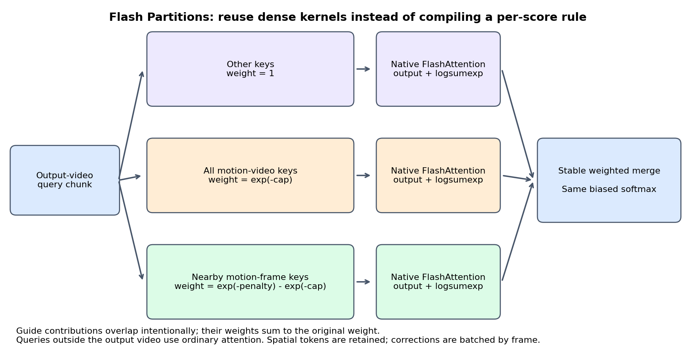

# Flash Partitions for H3 native temporal alignment

Flash Partitions is an inference implementation of BFS's bounded temporal attention rule. It retains the native video reference and the same temporal RoPE alignment, while evaluating the biased attention through native FlashAttention calls and stable partition merging. It requires no new learned weights and no per-score `torch.compile` kernel.

**Scope:** this is an experimental backend, not a claim of universal acceleration or identity preservation. The equations are equivalent in real arithmetic; FP16/BF16 implementations are not bit-identical. Dense attention still has quadratic work in sequence length.

## 1. What receives the temporal bias?

H3 packs text, reference pictures, native motion-video latents, audio and output-video latents into one sequence. Only **output-video queries consulting the selected motion video's keys** receive our temporal penalty. Image-reference coordinates remain native, as do the guide's spatial coordinates. The guide's temporal RoPE origin is aligned to the output clock before attention.



The matrix above is illustrative, not a measured attention map or actual token-count distribution. Color shows the multiplier of an **unnormalized** softmax weight, not the final attention probability. All keys remain available. Gray edges retain their original score rule; their final normalized probabilities can still change because the softmax denominator changes.

For an affected query/key pair, define:

```text
dt = abs(output_time - guide_time)
penalty(dt) = min(strength * (max(dt - window, 0) / falloff)^2, cap)
modified_score = dot(Q, K) / sqrt(head_dim) - penalty(dt)
```

Defaults: strength 2.0, window 0.20 seconds, falloff 0.25 seconds, cap 6.0. Both videos must have matching temporal grids. This experiment uses 24 fps. This is a soft preference for corresponding times; it is not a proof of physical motion correspondence.

## 2. Why the original FlexAttention path can be slower

The original backend evaluates a score modifier inside compiled FlexAttention. Its rule includes time lookup, distance, a bounded quadratic penalty and edge selection. The expression is evaluated over attention score tiles across heads and blocks. It never creates a full S×S bias tensor, but the extra per-score work remains.

At 116,883 sequence rows and 56 heads, the conceptual full score space contains roughly 765 billion query/key/head combinations per attention block. Kernels tile that computation rather than storing all those scores simultaneously. A new compiled shape/backend can also require initialization or compilation; native FlashAttention avoids that particular custom-kernel compilation path.

The whole model additionally spends time on projections, MLPs, quantized weights, model management, preview decoding and potentially CPU/GPU offload. Large native guide sequences increase both compute and live tensor sizes. We have not measured each of those contributions in the user's full workflow, so a slow step must not automatically be labeled “compiling” or “offloading.” GPU utilization alone cannot distinguish them.

## 3. Decompose the same rule into positive contributions

Because `0 <= penalty <= cap`, the guide's exponential score factor can be written as:

```text
exp(-penalty) = exp(-cap) + [exp(-penalty) - exp(-cap)]
```

Both contributions are nonnegative. At distant times the penalty reaches its cap, so the bracketed local correction is exactly zero. The baseline contribution remains positive: distant guide keys are not removed.



With the defaults, the correction reaches zero at:

```text
window + falloff * sqrt(cap / strength)
= 0.20 + 0.25 * sqrt(6 / 2)
≈ 0.633 seconds
```

That threshold applies to the correction, not to the availability of guide keys.

| Time difference | Penalty | Required factor | Global baseline | Local correction |
|---|---:|---:|---:|---:|
| 0.00 s | 0.00 | 1.000000 | 0.002479 | 0.997521 |
| 0.40 s | 1.28 | 0.278037 | 0.002479 | 0.275559 |
| 0.80 s | 6.00 | 0.002479 | 0.002479 | 0.000000 |

The inference backend computes three types of contributions:

1. All non-motion keys, with ordinary weight 1. They can occupy multiple contiguous segments.
2. All motion-video keys, with uniform factor `exp(-cap)`.
3. Nearby motion-frame keys, with factor `exp(-penalty) - exp(-cap)`.

The last two contributions intentionally overlap in their keys. Their exponential weights add to the intended original weight, so this does not double-count the final distribution. All spatial tokens of a source frame have the same temporal correction for a given output frame. Frame batching exploits that repeated structure. It is unrelated to averaging generated RGB frames or merging outputs from separate video generations.



## 4. Why log-sum-exp is necessary

A normal attention call returns a normalized local result. Averaging those results would assign equal importance to partitions with very different softmax mass. We therefore retain each partition's natural-log normalizer, `L_i`.

For partition output `O_i` and nonnegative multiplier `w_i`:

```text
adjusted_L_i = L_i + log(w_i)
L = logsumexp(adjusted_L_1, adjusted_L_2, ...)
O = sum_i exp(adjusted_L_i - L) * O_i
```

Zero-weight corrections can be omitted. The code uses `logaddexp` for successive merges and `expm1` to calculate small positive correction weights stably. It does not subtract two large attention outputs.

Output-frame chunks default to eight latent frames. This bounds the temporary merge buffers. It does not crop the output into independently generated clips or restrict the keys to those eight frames. Queries outside the output video use ordinary full attention.

Setting strength or cap to zero removes the score penalty in this backend; the separate temporal RoPE alignment remains active. Bypassing the temporal node/mode removes both changes.

## 5. What was measured?

### Isolated synthetic attention

RTX PRO 6000 Blackwell, PyTorch 2.12.0+cu130, BF16, 107,126 tokens, 8 heads, head dimension 128:

| Backend | Approximate attention call time |
|---|---:|
| Unmodified native PyTorch FlashAttention | 0.327 s |
| Flash Partitions | 0.422 s |
| Original temporal FlexAttention | 0.628 s |

The training process was running concurrently. These short microbenchmarks indicate about 1.5× improvement over the original temporal backend for that tested shape; they are not a controlled full-model speed claim, do not use H3's full 56 heads and do not establish RTX 5090 performance. For a small 2,272-token shape, partition-launch/merge overhead made this backend slower than FlexAttention. There is no universally fastest choice demonstrated here.

A separate small CUDA comparison against SDPA with an explicit temporal bias measured relative output norm error 0.00452 in BF16. CPU tests exercise the decomposition against the original score rule at multiple strengths/caps and with frame-chunk boundaries. This validates numerical behavior, not identity or motion quality.

### User-reported full-workflow logs

RTX 5090, requested output 544×928 and 360 frames:

| Temporal backend | Guide scale | Guide rows | Packed rows | First complete model evaluation |
|---|---:|---:|---:|---:|
| Flash Partitions | 1.0 | 52,751 | 116,883 | 179.18 s |
| Flash Partitions | 0.5 | 11,984 | 70,020 | 54.45 s |

The second model evaluation at scale 0.5 was reported as 47.19 s. These are user logs, not a controlled benchmark with all settings and warm-up conditions audited. The original Flex sampler's first step was reported as 603.40 s, including initialization, so it is not directly comparable to a warmed-up attention call.

The separately reported first-attention times were 2.689 s at scale 1.0 and 4.113 s at scale 0.5. That first-call measurement is not representative of every block; do not multiply it by the number of blocks to estimate the full step. Whole-model evaluation timing is the more useful end-to-end observation here.

## 6. How to use it

See [native temporal setup](../H3_NATIVE_TEMPORAL.md) for MODEL routing and the conditioning contract.

- Standalone node: select `attention_backend = flash partitions (no compile)`.
- Shot Conditioning: select `guide_mode = native temporal alignment (experimental)` and `native_temporal_backend = flash partitions (no compile)`.
- Use only one temporal patch on the MODEL path. Keep Add Guide and conflicting attention/block replacements disabled.
- `native_guide_scale = 1.0` preserves source detail. Try 0.5 for a lower-token motion reference; this keeps output dimensions, identity images and all guide frames/timestamps, but reduces guide spatial detail. H3 dimension rounding means the token reduction is not exactly fourfold.
- For standalone conditioning, resize only the guide video before native Reference to Video to obtain that spatial reduction.

The selected video is still VAE-encoded as a native reference. “Add Guide OFF” does not mean “no guide-video latents.” Qwen also sees the native video presentation. Reducing Qwen sampling alone would not remove the native DiT reference tokens.

## 7. Backend requirements and limitations

The current compile-free path calls PyTorch's native CUDA FlashAttention primitive with log-sum-exp outputs. It requires CUDA FP16/BF16 and a compatible PyTorch build. It is inference-only, supports one packed self-attention sequence and requires contiguous video rows, fixed spatial token count per frame and matching guide/output temporal grids. It does not use the ComfyUI attention backend selector for the modified main attention.

Comfy Kitchen INT8 attention's audited public API returns the output tensor but no log-sum-exp normalizer. It is therefore not a drop-in replacement for these partition calls. Its support for masks does not by itself provide a fused temporal rule without constructing a bias representation. A future hybrid could use it on unaffected queries; the current backend does not implement that hybrid. Updating ComfyUI alone will not redirect this node's explicit PyTorch calls.

Flash Partitions preserves the dense score policy and its quadratic work. More speed may require reducing native guide tokens, improving kernels/merges or choosing a measured alternative. Hard windows, sparse routing or independently generated temporal chunks would change behavior and need separate quality evaluation.

Alignment does not guarantee identity binding. The user has reported useful results from the existing 10500 LoRA plus this patch, and weaker identity retention from an early fresh-native checkpoint. Those are qualitative observations, not a matched-training comparison or evidence that the patch alone teaches swapping. No LoRA strength ramp, image-reference boost or identity loss is implemented by this backend.

## Video example

See the [synchronized six-column video and interpretation](../H3_NATIVE_TEMPORAL.md#video-comparison-an-add-guide-trained-lora-with-native-temporal-alignment), including the step-10500 Add Guide-trained LoRA running with the new native temporal method. The separate early step-750 identity-drift report is distinguished there.

## Source and reproducible figures

- [Partition planning, native FlashAttention and stable merge](../minimax_h3_temporal_fast.py)
- [MODEL wrapper, layout alignment and backend selection](../minimax_h3_native_temporal.py)
- [Original temporal score policy / Flex backend](../minimax_h3_native_temporal_core.py)
- [Numerical decomposition test](../tests/test_minimax_h3_temporal_fast.py)
- [Figure source](illustrations/render_h3_flash_partitions.py), with exported SVGs beside the PNGs.

Figures can be regenerated on CPU with Python, NumPy and Matplotlib:

```bash
python docs/illustrations/render_h3_flash_partitions.py
```

The illustrations describe the mechanism; they are not generated attention measurements or model-output examples.
